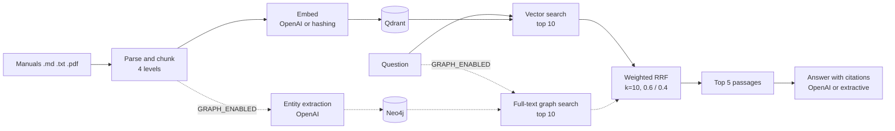

# service-manual-rag

Retrieval-augmented question answering over industrial equipment service manuals, with hybrid vector and knowledge graph retrieval, a multi-agent troubleshooting workflow and an evaluation harness that runs offline.

<picture>
  <source media="(prefers-color-scheme: dark)" srcset="docs/figures/baseline-summary-dark.svg">
  
</picture>

## What it does

- Parses manuals (Markdown or text; PDF with the `pdf` extra) into a four-level chunk hierarchy: document, section, subsection, semantic chunk.
- Indexes chunks in Qdrant and, optionally, extracts entities such as components, symptoms, procedures and parts into a Neo4j knowledge graph.
- Answers a question from the top passages of both retrievers, merged with weighted Reciprocal Rank Fusion, and cites each passage as `[Source N]`.
- Runs a LangGraph workflow with a supervisor, a diagnostic agent and an action agent for multi-turn troubleshooting, with a Streamlit UI.
- Scores the pipeline on a golden question set with RAGAS-style metrics plus direct retrieval metrics.
- Runs end to end without network access or API keys: an offline mode swaps in a hashing embedder, an extractive answerer and a lexical judge.

## How it works



Ingestion parses each manual, builds the chunk hierarchy and indexes the level 4 chunks by default. A query runs vector search and, when `GRAPH_ENABLED=true`, a Neo4j full-text search. Each result list contributes `weight / (k + rank)` to a passage's fused score. The five best passages go to the answer generator. A failed graph search is logged and returned in the response metadata; the answer then uses vector results only.

`LLM_MODE` selects the components. `openai` uses `text-embedding-3-large` embeddings, a chat model for answers and an LLM judge. `offline` uses deterministic stand-ins with no network access. `auto`, the default, picks `openai` when `OPENAI_API_KEY` is set. Defaults are in [service_manual_rag/config/settings.py](service_manual_rag/config/settings.py) and every variable is listed in [.env.example](.env.example).

## Results

All figures below come from [results/offline-baseline.json](results/offline-baseline.json), produced by `service-manual-rag evaluate --output results/offline-baseline.json` in offline mode on the 3 manuals in [sample_data/manuals/](sample_data/manuals/) and the 15 questions in [sample_data/golden_set.json](sample_data/golden_set.json). The run is deterministic; CI regenerates the file and fails if it changes. The chart data is in [docs/data.json](docs/data.json).

<picture>
  <source media="(prefers-color-scheme: dark)" srcset="docs/figures/offline-metrics-dark.svg">
  
</picture>

<details><summary>Data table</summary>

| Metric | Value | Definition |
|---|---|---|
| section_hit | 73.3% | Share of questions with a top 5 passage from the golden subsection of the named manual |
| reciprocal_rank | 55% | Mean of 1 / rank of that passage, 0 when absent |
| model_precision | 53.3% | Share of top 5 passages that come from the manual the question names |
| correctness (token F1) | 40.5% | Token F1 between answer and ground truth, stopwords removed |
| answer_relevance | 39.3% | Share of question terms present in the answer |
| context_relevance | 26.8% | Mean share of question terms present in each passage |
| faithfulness | 100% | Mean share of answer sentence terms present in the passages |

Source: `results/offline-baseline.json (aggregate)`

</details>

<picture>
  <source media="(prefers-color-scheme: dark)" srcset="docs/figures/section-hit-by-category-dark.svg">
  
</picture>

<details><summary>Data table</summary>

| Category | Section hit |
|---|---|
| safety | 100% |
| specifications | 100% |
| maintenance | 100% |
| operation | 66.7% |
| troubleshooting | 0% |

Source: `results/offline-baseline.json (by_category.*.section_hit)`

</details>

The offline numbers measure lexical overlap. They are a reproducible floor for regression tests and are not comparable with LLM-judged RAGAS scores. With `LLM_MODE=openai` the same command scores the OpenAI pipeline with an LLM judge; no such run is recorded in this repository.

## Quickstart

Requires Python 3.11 or later and [uv](https://docs.astral.sh/uv/).

```bash
git clone https://github.com/darblinko/service-manual-rag
cd service-manual-rag
uv sync --extra dev
LLM_MODE=offline uv run service-manual-rag quickstart
```

`quickstart` indexes the sample manuals into an embedded Qdrant store under `data/`, answers one sample question and writes `results/evaluation.json`. Other commands:

```bash
uv run service-manual-rag ingest --manuals path/to/manuals --reset
uv run service-manual-rag ask "What is the torque for the CP-200 impeller nut?"
uv run service-manual-rag evaluate --golden-set sample_data/golden_set.json
```

Full test suite, lint and the UI:

```bash
uv sync --extra dev --extra agents --extra ui
uv run pytest -q
uvx ruff@0.17.3 check . && uvx ruff@0.17.3 format --check .
uv run streamlit run ui/app.py
```

The knowledge graph panel on the Agent Chat page also needs `streamlit-agraph`, which is not in the `ui` extra.

OpenAI mode: copy `.env.example` to `.env`, set `OPENAI_API_KEY` and `LLM_MODE=openai`, then run `ingest --reset` again, because the collection is sized for the active embedder. Graph retrieval: set `NEO4J_PASSWORD` and `GRAPH_ENABLED=true`, then `docker compose up -d neo4j`. `docker compose up -d qdrant` with `QDRANT_MODE=server` replaces the embedded store.

## Sample data

The sample corpus is original synthetic text written for this repository. The manufacturer ExampleCo, the equipment, part numbers and values are fictional. Do not use them to service real equipment.

| File | Contents | License |
|---|---|---|
| [sample_data/manuals/exampleco-cp-200-centrifugal-pump.md](sample_data/manuals/exampleco-cp-200-centrifugal-pump.md) | CP-200 centrifugal pump, 7 pages, 18 subsections | Apache-2.0 |
| [sample_data/manuals/exampleco-rsc-15-rotary-screw-compressor.md](sample_data/manuals/exampleco-rsc-15-rotary-screw-compressor.md) | RSC-15 rotary screw compressor, 7 pages, 17 subsections | Apache-2.0 |
| [sample_data/manuals/exampleco-em-30-induction-motor.md](sample_data/manuals/exampleco-em-30-induction-motor.md) | EM-30 induction motor, 7 pages, 17 subsections | Apache-2.0 |
| [sample_data/golden_set.json](sample_data/golden_set.json) | 15 questions, 5 per manual, 3 per category, each with a ground truth and an expected subsection | Apache-2.0 |

Each manual states its license in its front matter. Manuals use front matter for `oem` and `model`, `#` to `###` headings, `<!-- page: N -->` page markers, list items and pipe tables; the conventions are documented in [service_manual_rag/processing/markdown_parser.py](service_manual_rag/processing/markdown_parser.py).

## Project layout

```
service_manual_rag/
  cli.py              ingest, ask, evaluate, quickstart
  config/             settings from environment variables and .env
  processing/         Markdown and PDF parsers, hierarchical chunker
  embeddings/         OpenAI and hashing embedders, Qdrant indexer
  vector_db/          Qdrant client and collection schema
  knowledge_graph/    Neo4j client and graph schema
  graph_builder/      entity extraction and graph population
  rag/                hybrid retriever, RRF fusion, answer generators, pipelines
  agents/             supervisor, diagnostic and action agents, LangGraph workflow
  evaluation/         golden set loader, judges, RAGAS-style evaluator
ui/                   Streamlit app and pages
scripts/              database setup, cleanup and retrieval diagnostics
sample_data/          synthetic manuals and the golden question set
results/              committed offline baseline
docs/                 landing page, chart data and README figures
tests/                offline test suite
```

## Design decisions and limitations

- Four-level chunks keep section and subsection context for each passage. Only level 4 chunks are indexed by default (`ingest --levels` changes this), so the evaluation measures passage-level retrieval.
- RRF uses k=10 instead of the common 60, because each result list holds at most 10 items; weights are 0.6 vector and 0.4 graph. Neither value was tuned on a measured graph run.
- The offline embedder hashes unigrams and bigrams into 512 dimensions after dropping stopwords. It matches shared terms only.
- Negative result: 4 of 15 questions missed their expected section, including all 3 troubleshooting questions. The missed questions share some terms with their target subsection (for example the alarm code `e06` in rsc15-04), but the hashing embedder ranked passages from other subsections higher, often from other manuals. Source: `per_question` in results/offline-baseline.json.
- Negative result: 53.3% of retrieved passages come from the manual the question names. The embedded level 4 chunk text starts with the subsection heading but is not prefixed with the model name, so a model name in the question only matches passages whose own text mentions it. `RAGPipeline.query` accepts a `filters` argument that can restrict retrieval to one model; nothing sets it from the question yet.
- Faithfulness is 100% by construction for the extractive answerer, which only copies retrieved sentences. The metric becomes informative with a generative model.
- The evaluator follows the RAGAS metric definitions but does not use the ragas package. A failed judgment is recorded under `errors` for that question and left out of the means instead of being replaced by a default score.
- The knowledge graph path needs a running Neo4j and OpenAI entity extraction. The test suite does not run it against a live database, and no graph result is measured here.
- The agents fall back to keyword rules when OpenAI is not configured; image and video analysis needs `GOOGLE_API_KEY`. Agent behaviour is covered by unit tests, not by a measured evaluation.
- The golden set has 15 questions over 3 synthetic manuals. It detects regressions; it does not estimate accuracy on real manuals.

## License

Apache-2.0. See [LICENSE](LICENSE).
