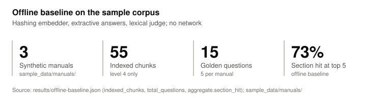
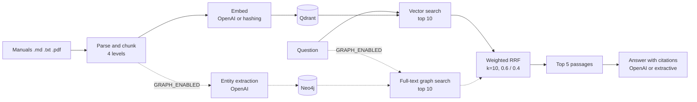
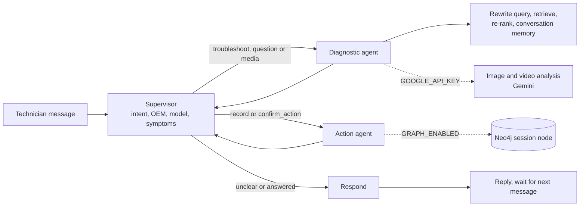
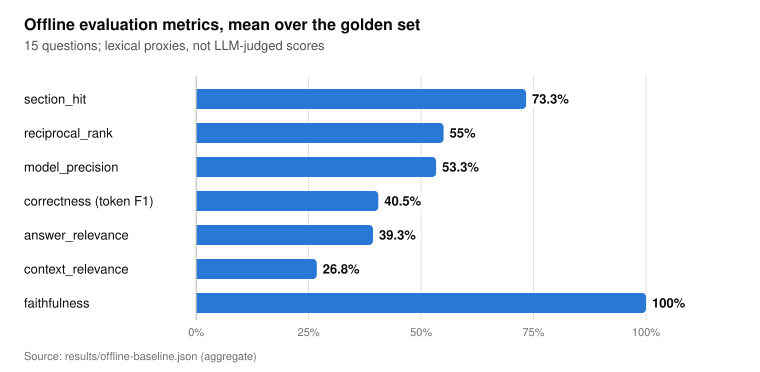
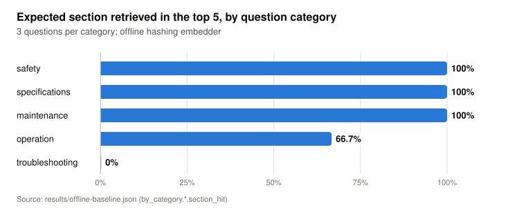
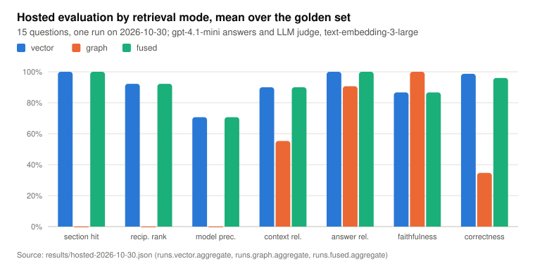

# service-manual-rag

Retrieval-augmented question answering over industrial equipment service manuals, with hybrid vector and knowledge graph retrieval, a multi-agent troubleshooting workflow and an evaluation harness that runs offline.

<picture>
  <source media="(prefers-color-scheme: dark)" srcset="docs/figures/baseline-summary-dark.svg">
  
</picture>

## What it does

- Parses manuals (Markdown or text; PDF with the `pdf` extra) into a four-level chunk hierarchy: document, section, subsection, semantic chunk. A script downloads a public-domain FAA PDF corpus and checks each file against a recorded SHA-256.
- Indexes chunks in Qdrant and, optionally, extracts entities such as components, symptoms, procedures and parts into a Neo4j knowledge graph.
- Answers a question from the top passages of both retrievers, merged with weighted Reciprocal Rank Fusion, and cites each passage as `[Source N]`.
- Runs a LangGraph workflow with a supervisor, a diagnostic agent and an action agent for multi-turn troubleshooting, with a Streamlit UI that also runs offline.
- Scores the pipeline on a golden question set with RAGAS-style metrics plus direct retrieval metrics.
- Runs end to end without network access or API keys: an offline mode swaps in a hashing embedder, an extractive answerer and a lexical judge.

## How it works



Ingestion parses each manual, builds the chunk hierarchy and indexes the level 4 chunks by default. A query runs vector search and, when `GRAPH_ENABLED=true`, a Neo4j full-text search. Each result list contributes `weight / (k + rank)` to a passage's fused score. The five best passages go to the answer generator. A failed graph search is logged and returned in the response metadata; the answer then uses vector results only.

### Agent layer



The graph is built in [service_manual_rag/agents/workflow.py](service_manual_rag/agents/workflow.py). The supervisor classifies each message as `troubleshoot`, `question`, `record`, `confirm_action` or `unclear`, with the chat model when OpenAI is configured and with keyword rules otherwise. It extracts the manufacturer from `KNOWN_OEMS` or a phrase such as "made by X", plus the model and symptoms. Uploaded images or video go to the diagnostic agent whatever the intent.

The diagnostic agent searches the manuals when the state holds a symptom or a manufacturer. The search rewrites the query (chat model, or offline synonym expansion), retrieves passages, re-ranks them (cross-encoder when `sentence-transformers` is installed, score-based otherwise) and stores each turn in the Qdrant collection `conversation_memory`. Hypotheses come from the LLM reasoner or from keyword rules; with `GRAPH_ENABLED=true` it also turns recorded sessions with matching symptoms into hypotheses. The action agent records the session as a `TroubleshootingSession` node for those later lookups, which needs the knowledge graph. After a specialist agent returns, the supervisor routes the same message to `respond`, which writes the reply.

### Configuration

`LLM_MODE` selects the components. `openai` uses `text-embedding-3-large` embeddings, a chat model for answers and an LLM judge. `offline` uses deterministic stand-ins with no network access. `auto`, the default, picks `openai` when `OPENAI_API_KEY` is set. Defaults are in [service_manual_rag/config/settings.py](service_manual_rag/config/settings.py) and every variable is listed in [.env.example](.env.example). Model names are environment variables:

| Variable | Default | Used by |
|---|---|---|
| `OPENAI_MODEL` | `gpt-4.1-mini` | Answers, LLM judge, entity extraction, supervisor intent, diagnostic reasoning, query rewriting |
| `OPENAI_EMBEDDING_MODEL` | `text-embedding-3-large` (3072 dimensions) | Embeddings in `openai` mode |
| `GEMINI_MODEL` | `gemini-2.5-flash` | Image and video analysis, only with `GOOGLE_API_KEY` |
| `RERANKER_MODEL` | `cross-encoder/ms-marco-MiniLM-L-6-v2` | Agent re-ranker, only with `sentence-transformers` installed |
| `PDF_STRATEGY` | `hi_res` | Unstructured partition strategy for PDF manuals |

The chat call sites set `temperature`, so `OPENAI_MODEL` must name a model that accepts it; the GPT-5 reasoning models reject a non-default temperature.

## Results

Two runs are recorded: an offline baseline and one hosted run with an LLM judge. The chart data for both is in [docs/data.json](docs/data.json).

### Offline baseline

The figures in this subsection come from [results/offline-baseline.json](results/offline-baseline.json), produced by `service-manual-rag evaluate --output results/offline-baseline.json` in offline mode on the 3 manuals in [sample_data/manuals/](sample_data/manuals/) and the 15 questions in [sample_data/golden_set.json](sample_data/golden_set.json). The run is deterministic; CI regenerates the file and fails if it changes.

<picture>
  <source media="(prefers-color-scheme: dark)" srcset="docs/figures/offline-metrics-dark.svg">
  
</picture>

<details><summary>Data table</summary>

| Metric | Value | Definition |
|---|---|---|
| section_hit | 73.3% | Share of questions with a top 5 passage from the golden subsection of the named manual |
| reciprocal_rank | 55% | Mean of 1 / rank of that passage, 0 when absent |
| model_precision | 53.3% | Share of top 5 passages that come from the manual the question names |
| correctness (token F1) | 40.5% | Token F1 between answer and ground truth, stopwords removed |
| answer_relevance | 39.3% | Share of question terms present in the answer |
| context_relevance | 26.8% | Mean share of question terms present in each passage |
| faithfulness | 100% | Mean share of answer sentence terms present in the passages |

Source: `results/offline-baseline.json (aggregate)`

</details>

<picture>
  <source media="(prefers-color-scheme: dark)" srcset="docs/figures/section-hit-by-category-dark.svg">
  
</picture>

<details><summary>Data table</summary>

| Category | Section hit |
|---|---|
| safety | 100% |
| specifications | 100% |
| maintenance | 100% |
| operation | 66.7% |
| troubleshooting | 0% |

Source: `results/offline-baseline.json (by_category.*.section_hit)`

</details>

The offline baseline uses a lexical judge and extractive answer generation, so these numbers measure lexical overlap. They are a reproducible floor for regression tests and are not comparable with LLM-judged RAGAS scores. Graph retrieval is off in this run, so the scores are for vector retrieval alone.

### Hosted evaluation by retrieval mode

The figures in this subsection come from [results/hosted-2026-10-30.json](results/hosted-2026-10-30.json), one run on 2026-10-30 at commit `a2f53c1` by [scripts/hosted_evaluation.py](scripts/hosted_evaluation.py). Each of the 15 golden questions was answered by `gpt-4.1-mini` from the top 5 fused passages, and the same model, `gpt-4.1-mini`, scored each answer as an LLM judge. Embeddings are `text-embedding-3-large` at 3072 dimensions. The corpus is the 3 Markdown manuals in [sample_data/manuals/](sample_data/manuals/): 55 indexed level 4 chunks in Qdrant, and a Neo4j graph of 1,271 nodes and 1,031 relationships extracted by `gpt-4.1-mini` from every section, subsection and semantic chunk. The FAA PDFs are not in this corpus; see the PDF limitation below. Retrieval settings are the defaults: 10 vector and 10 graph results, RRF k=10, weights 0.6 and 0.4, top 5 to the answer. No judgment and no graph search failed in any mode.

<picture>
  <source media="(prefers-color-scheme: dark)" srcset="docs/figures/hosted-by-mode-dark.svg">
  
</picture>

<details><summary>Data table</summary>

|  | vector | graph | fused |
|---|---|---|---|
| section hit | 100% | 0% | 100% |
| recip. rank | 92.2% | 0% | 92.2% |
| model prec. | 70.7% | 0% | 70.7% |
| context rel. | 90% | 55.3% | 90% |
| answer rel. | 100% | 90.7% | 100% |
| faithfulness | 86.7% | 100% | 86.7% |
| correctness | 98.7% | 34.7% | 96% |

Source: `results/hosted-2026-10-30.json (runs.vector.aggregate, runs.graph.aggregate, runs.fused.aggregate)`

</details>

- The judge is an LLM, and it is the same model that wrote the answers. The scores are from one run of 15 questions; answers are sampled at temperature 0.3 and judgments at 0.0. Metric definitions are in the offline data table above. Source: [service_manual_rag/rag/answering.py](service_manual_rag/rag/answering.py), [service_manual_rag/evaluation/judges.py](service_manual_rag/evaluation/judges.py).
- Fused and vector modes retrieved the same manual model and subsection at each of the 5 ranks for all 15 questions (`per_question[].retrieved` in the results file). Inference from the fusion formula: the best graph result scores 0.4 / 11 = 0.0364, below the fifth vector result at 0.6 / 15 = 0.04, so with these weights graph results cannot enter the top 5 while vector search returns 5 or more passages. Inference: the correctness difference between the two modes (98.7% and 96%) comes from answer generation and judging, not from retrieval.
- Graph mode scores 0 on section hit, reciprocal rank and model precision by construction. The full-text search returns entity nodes (components, failure modes, solutions and others) that carry no manual model or subsection name, so `retrieval_scores` cannot match them to a golden section. Its answer-level scores are measured: correctness 34.7%, with 10 of 15 questions scored below 0.8 (`runs.graph.per_question`).
- Faithfulness is 0 for 2 of 15 questions (cp200-03 and rsc15-04) in vector and fused modes. The judge sees the first 500 characters of each passage (`CONTEXT_PREVIEW_CHARS` in judges.py), so an answer drawn from later text in a passage can be scored unsupported; this cause was not checked per question.
- Token usage of the answer and judge calls is in `runs.*.usage`: 225 chat calls, 152,614 prompt and 39,482 completion tokens over the three modes. Entity extraction during ingestion is not counted there.

Reproduce, with `OPENAI_API_KEY` and `NEO4J_PASSWORD` set and `docker compose up -d neo4j` running:

```bash
export LLM_MODE=openai GRAPH_ENABLED=true QDRANT_LOCAL_PATH=data/qdrant_hosted
uv run service-manual-rag ingest --reset --graph
uv run python scripts/hosted_evaluation.py --output results/hosted-$(date +%F).json \
  --corpus sample_data/manuals/*.md
```

## Quickstart

Requires Python 3.11 or later and [uv](https://docs.astral.sh/uv/).

```bash
git clone https://github.com/darblinko/service-manual-rag
cd service-manual-rag
uv sync --extra dev
LLM_MODE=offline uv run service-manual-rag quickstart
```

`quickstart` indexes the sample manuals into an embedded Qdrant store under `data/`, answers one sample question and writes `results/evaluation.json`. Other commands:

```bash
uv run service-manual-rag ingest --manuals path/to/manuals --reset
uv run service-manual-rag ingest --reset --graph   # also build the Neo4j graph (OpenAI, Neo4j)
uv run service-manual-rag ask "What is the torque for the CP-200 impeller nut?"
uv run service-manual-rag evaluate --golden-set sample_data/golden_set.json
```

Full test suite and lint:

```bash
uv sync --extra dev --extra agents --extra ui
uv run pytest -q
uvx ruff@0.17.3 check . && uvx ruff@0.17.3 format --check .
```

The Streamlit UI in offline mode, on the sample manuals:

```bash
uv sync --extra dev --extra agents --extra ui
LLM_MODE=offline uv run service-manual-rag ingest --reset
LLM_MODE=offline uv run streamlit run ui/app.py
```

The pages are Process, Query, Documents and Agent Chat. In offline mode Agent Chat shows a banner, routes with keyword rules and answers with excerpts from the indexed manuals. A first message needs a manufacturer or a symptom before the diagnostic agent searches, for example "What is the impeller nut torque on the ExampleCo CP-200?". The knowledge graph panel on the Agent Chat page also needs `streamlit-agraph`, which is not in the `ui` extra.

OpenAI mode: copy `.env.example` to `.env`, set `OPENAI_API_KEY` and `LLM_MODE=openai`, then run `ingest --reset` again, because the collection is sized for the active embedder. Graph retrieval: set `NEO4J_PASSWORD` and `GRAPH_ENABLED=true` in `.env`, then `docker compose up -d neo4j`; compose and the application both read `NEO4J_PASSWORD`. Compose has a fallback password for it only so that `docker compose up -d qdrant` starts without one; that fallback is a published local development default. `docker compose up -d qdrant` with `QDRANT_MODE=server` replaces the embedded store. Compose binds the Qdrant and Neo4j ports to 127.0.0.1, and Qdrant runs without authentication, so the compose file is for a local development machine only.

## Sample data

The sample corpus is original synthetic text written for this repository. The manufacturer ExampleCo, the equipment, part numbers and values are fictional. Do not use them to service real equipment.

| File | Contents | License |
|---|---|---|
| [sample_data/manuals/exampleco-cp-200-centrifugal-pump.md](sample_data/manuals/exampleco-cp-200-centrifugal-pump.md) | CP-200 centrifugal pump, 7 pages, 18 subsections | Apache-2.0 |
| [sample_data/manuals/exampleco-rsc-15-rotary-screw-compressor.md](sample_data/manuals/exampleco-rsc-15-rotary-screw-compressor.md) | RSC-15 rotary screw compressor, 7 pages, 17 subsections | Apache-2.0 |
| [sample_data/manuals/exampleco-em-30-induction-motor.md](sample_data/manuals/exampleco-em-30-induction-motor.md) | EM-30 induction motor, 7 pages, 17 subsections | Apache-2.0 |
| [sample_data/golden_set.json](sample_data/golden_set.json) | 15 questions, 5 per manual, 3 per category, each with a ground truth and an expected subsection | Apache-2.0 |

Each manual states its license in its front matter. Manuals use front matter for `oem` and `model`, `#` to `###` headings, `<!-- page: N -->` page markers, list items and pipe tables; the conventions are documented in [service_manual_rag/processing/markdown_parser.py](service_manual_rag/processing/markdown_parser.py).

## Public-domain PDF corpus

[scripts/fetch_public_corpus.py](scripts/fetch_public_corpus.py) downloads the PDFs listed in [sample_data/public_domain/manifest.json](sample_data/public_domain/manifest.json) into `data/public_corpus/`, which git ignores. It keeps a file only when its SHA-256 matches the manifest, and then indexes it through the PDF parser. The PDFs are not committed.

| id | Document | Pages | Bytes | URL |
|---|---|---|---|---|
| `faa-h-8083-32b-ch10` | Aviation Maintenance Technician Handbook, Powerplant (FAA-H-8083-32B, 2023), Chapter 10: Engine Maintenance and Operation | 65 | 14,227,775 | https://www.faa.gov/sites/faa.gov/files/12_amtp_ch10_0.pdf |
| `faa-h-8083-32b-ch06` | Aviation Maintenance Technician Handbook, Powerplant (FAA-H-8083-32B, 2023), Chapter 6: Lubrication and Cooling Systems | 40 | 19,072,507 | https://www.faa.gov/sites/faa.gov/files/08_amtp_ch6.pdf |
| `faa-ac-150-5340-26c` | AC 150/5340-26C, Maintenance of Airport Visual Aid Facilities (2014) | 144 | 2,683,370 | https://www.faa.gov/documentLibrary/media/Advisory_Circular/150-5340-26c.pdf |

All three are publications of the Federal Aviation Administration. As works of the United States Government they are not subject to copyright in the United States (17 U.S.C. 105). The handbook front matter credits some images to third parties; the pipeline indexes text only. The two handbook chapters contain symptom, cause and remedy tables (Figures 6-30, 10-52, 10-75 and 10-76); the advisory circular describes troubleshooting of series lighting circuits in Chapter 6.

```bash
uv sync --extra dev --extra pdf
uv run python scripts/fetch_public_corpus.py --no-ingest   # download and verify only
uv run python scripts/fetch_public_corpus.py               # verify, then index into the collection
```

`--reset` recreates the collection first, `--strategy` overrides `PDF_STRATEGY` and `--levels` selects the chunk levels to index. `--graph` also extracts entities from every chunk into Neo4j, as `ingest --graph` does. The `hi_res` strategy downloads a layout model on first use and needs poppler and tesseract; `fast` reads the text layer. All three files have a text layer, but Unstructured 0.27.35 (the version in uv.lock) flags each of them as too complex for text extraction, because a page exceeds its graphics operator thresholds, and falls back to `hi_res` even under `fast` (checked with `unstructured.partition.pdf.is_pdf_too_complex` on 2026-10-30). Indexing them therefore needs the `hi_res` layout model. Unstructured also sends a telemetry request to packages.unstructured.io on import unless `DO_NOT_TRACK` or `SCARF_NO_ANALYTICS` is set. The locked Unstructured 0.27.35 does not install nltk, so the NLTK data `punkt_tab` and `averaged_perceptron_tagger_eng` was not needed in this environment; when no text is extracted the parser raises an error. The agents find these documents by manufacturer when `KNOWN_OEMS` includes `FAA`, for example `KNOWN_OEMS=ExampleCo,FAA`.

On 2026-10-30 faa.gov answered the script's request with HTTP 403. In that case the error names the target file: download the PDF in a browser, save it under that name and run the script again; it verifies a file already in place and does not download it.

## Project layout

```
service_manual_rag/
  cli.py              ingest, ask, evaluate, quickstart
  config/             settings from environment variables and .env
  processing/         Markdown and PDF parsers, hierarchical chunker
  embeddings/         OpenAI and hashing embedders, Qdrant indexer
  vector_db/          Qdrant client and collection schema
  knowledge_graph/    Neo4j client and graph schema
  graph_builder/      entity extraction and graph population
  rag/                hybrid retriever, RRF fusion, answer generators, pipelines
  agents/             supervisor, diagnostic and action agents, LangGraph workflow
  evaluation/         golden set loader, judges, RAGAS-style evaluator
ui/                   Streamlit app and pages
scripts/              public PDF corpus fetch, database setup, cleanup, retrieval diagnostics
sample_data/          synthetic manuals, golden question set, public-domain PDF manifest
results/              committed offline baseline and hosted run
docs/                 landing page, chart data and README figures
tests/                offline test suite
```

## Design decisions and limitations

- Four-level chunks keep section and subsection context for each passage. Only level 4 chunks are indexed by default (`ingest --levels` changes this), so the evaluation measures passage-level retrieval.
- RRF uses k=10 instead of the common 60, because each result list holds at most 10 items; weights are 0.6 vector and 0.4 graph. Neither value was tuned. In the hosted run these weights kept every graph result out of the top 5, so fused retrieval equalled vector retrieval; see the hosted results above.
- The offline embedder hashes unigrams and bigrams into 512 dimensions after dropping stopwords. It matches shared terms only.
- Negative result: 4 of 15 questions missed their expected section, including all 3 troubleshooting questions. The missed questions share some terms with their target subsection (for example the alarm code `e06` in rsc15-04), but the hashing embedder ranked passages from other subsections higher, often from other manuals. Source: `per_question` in results/offline-baseline.json.
- Negative result: 53.3% of retrieved passages come from the manual the question names. The embedded level 4 chunk text starts with the subsection heading but is not prefixed with the model name, so a model name in the question only matches passages whose own text mentions it. `RAGPipeline.query` accepts a `filters` argument that can restrict retrieval to one model; nothing sets it from the question yet.
- Faithfulness is 100% by construction for the extractive answerer, which only copies retrieved sentences. The metric becomes informative with a generative model.
- The evaluator follows the RAGAS metric definitions but does not use the ragas package. A failed judgment is recorded under `errors` for that question and left out of the means instead of being replaced by a default score.
- The knowledge graph path needs a running Neo4j and OpenAI entity extraction. The test suite does not run it against a live database. The vector, graph and fused comparison is measured only in the hosted run, because offline mode has no graph component. Graph search returns entity nodes rather than manual passages, so graph-only retrieval cannot be scored against the golden sections.
- The agents fall back to keyword rules when OpenAI is not configured; image and video analysis needs `GOOGLE_API_KEY`. Agent behaviour is covered by unit tests and a Streamlit page test; no evaluation of the agents is measured.
- The diagnostic agent searches the manuals only when the conversation holds a symptom or a manufacturer. A first question without either gets a request for more information.
- The PDF path is tested with stand-ins for Unstructured. The FAA corpus checksums were verified on 2026-10-30. Indexing those PDFs was not run: Unstructured 0.27.35 routes all three to `hi_res`, and its layout model was not downloaded in the environment used. No evaluation on the PDF corpus is recorded.
- The golden set has 15 questions over 3 synthetic manuals. It detects regressions; it does not estimate accuracy on real manuals.

## License

Apache-2.0. See [LICENSE](LICENSE).
